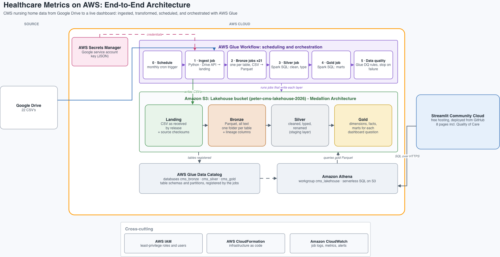

# Nursing Home Staffing & Quality Pipeline on AWS

An end-to-end, fully scheduled data pipeline that pulls CMS nursing home data from Google Drive into an AWS lakehouse (S3, Glue, Athena) and serves it in a Streamlit dashboard. It is a companion to the [Snowflake + dbt version](https://github.com/peter-rousseau518/healthcare-metrics-pipeline), which solves the same problem on a different platform, and the two produce identical results.

**Live dashboard:** [healthcare-metrics-aws.streamlit.app](https://healthcare-metrics-aws-ad4ahjn3zgikdyxnkpad9g.streamlit.app/)
*(Community Cloud apps sleep when idle. If you see a "wake up" button, click it and allow about 30 seconds.)*



## Questions this project answers

| Question | Answer in the data | Where |
|---|---|---|
| What is the relationship between nurse staffing levels and occupancy rates? | Almost none nationally: r = −0.08 between occupancy and licensed-nurse hours per resident day across 14,505 facilities, matching the Snowflake project exactly. | Staffing vs. occupancy tab |
| Which facilities have the highest nurse overtime hours? | Overtime can't be measured from public CMS data (no per-nurse hours or headcount). The dashboard ranks facilities by **contract (agency) RN + LPN hours**, the closest public signal. | Agency nurse hours tab |
| What are average staffing levels by state and facility type? | Averages for every state, with facility type defined three ways: ownership, provider type, and hospital-based vs. freestanding. | Staffing by state & type tab |
| Is nurse turnover higher where staffing is more strained? | Turnover is compared against **reliance on agency nurses** and weekend staffing drop, using rank correlation and turnover averages by strain level. | Strain vs. turnover tab |
| What trends appear in short-stay vs. long-stay care? | Length of stay isn't in the data; quality measures are trended for **short-stay vs. long-stay** residents across four quarters. | Short- vs. long-stay tab |
| How do readmissions, complaints, and staffing relate? | 30-day readmission rates by facility and state, **residents per nurse vs. complaint rate**, and **nurse staffing vs. readmissions**, each with rank correlation and averages by staffing level. | Quality of care tab |

The Quality of Care tab deliberately leaves out two requested metrics the data can't support: patient satisfaction (nursing home Care Compare has no satisfaction survey) and readmissions by diagnosis (requires patient-level claims data that isn't public). See [ADR-015](docs/decisions.md).

## Architecture

```mermaid
flowchart LR
    A[Google Drive<br/>22 CMS source files] -->|Glue Python job<br/>Drive API, service account| B[S3 landing<br/>raw CSVs]
    B -->|21 Glue Spark jobs<br/>one per table| C[Bronze<br/>Parquet, all text]
    C -->|Glue Spark SQL| D[Silver<br/>5 typed tables]
    D -->|Glue Spark SQL| E[Gold<br/>10 marts]
    E -->|Athena<br/>read-only IAM user| F[Streamlit dashboard]
    G[Glue Workflow<br/>monthly schedule] -.->|orchestrates| A
```



| Layer | Technology | Why |
|---|---|---|
| Ingestion | AWS Glue Python job + Google Drive API | Runs unattended inside AWS; the Google key lives in Secrets Manager ([ADR-003, ADR-004](docs/decisions.md)) |
| Storage | S3, one lakehouse bucket with a prefix per zone | Private, versioned, encrypted; simple permissions ([ADR-002](docs/decisions.md)) |
| Transformation | AWS Glue (PySpark and Spark SQL) | Classic AWS data engineering; metric definitions match the dbt models line for line ([ADR-007, ADR-008](docs/decisions.md)) |
| Query | Glue Data Catalog + Athena | Serverless SQL over Parquet; no clusters to run ([ADR-005](docs/decisions.md)) |
| Orchestration | Glue Workflow | Schedule, dependencies, and run history for all 24 jobs in one place ([ADR-009](docs/decisions.md)) |
| Infrastructure | CloudFormation | The whole environment is rebuilt from version-controlled templates ([ADR-012](docs/decisions.md)) |
| Dashboard | Streamlit on Community Cloud | The Snowflake project's app with only the connection replaced ([ADR-011](docs/decisions.md)) |

Every tool choice, including the ones considered and rejected, is recorded in [`docs/decisions.md`](docs/decisions.md) (18 decision records).

## Key results

- **Two platforms, identical answers.** Snowflake with dbt and AWS Glue with Spark both report **14,505** valid facilities and **r = −0.08** between occupancy and nurse staffing, from independent implementations of the same definitions ([ADR-018](docs/decisions.md)).
- **Readmissions:** the median facility rehospitalizes **23.1%** of short-stay residents (claims measure); the median SNF VBP 30-day readmission rate is **20.0%**.
- **Staffing in plain terms:** at the median facility, each licensed nurse on duty covers about **16.6 residents** at any given moment.
- **Complaints:** the median facility has **2.9 substantiated complaints per 100 residents**.

## Data quality

- **Every job checks its own output** and fails the workflow on any violation: no empty tables, unique non-null keys in silver and gold, and no missing source files ([ADR-016](docs/decisions.md)).
- **Silent failures are caught too:** the Quality of Care mart fails the run if its readmission columns come back empty, for example after a CMS measure code change.
- **Cross-checked against Snowflake (parallel project):** row counts and headline metrics match the first project ([ADR-018](docs/decisions.md)).
- **Tested before deployment:** every Glue job was run locally on Spark 3.5 (the Glue 5.0 engine) before going to AWS.

## Security

Each system has its own least-privilege identity, and no credential is stored in the repository.

| Identity | Can do |
|---|---|
| `cms-lakehouse-glue-role` (AWS IAM role) | Read and write the lakehouse bucket; read the Google key secret |
| `cms-drive-reader` (Google service account) | View one Drive folder; its key is held in AWS Secrets Manager |
| Dashboard IAM user | Run Athena queries in one workgroup and read the gold layer; keys stored only in Streamlit secrets |

## Cost

Built to cost cents per run. Athena bills by data scanned, the `cms_lakehouse` workgroup caps each query at 10 GB, query results and old object versions expire after 30 days, and the dashboard caches results for 24 hours ([ADR-013](docs/decisions.md)).

## Snowflake vs. AWS

| | [Snowflake project](https://github.com/peter-rousseau518/healthcare-metrics-pipeline) | This project |
|---|---|---|
| Ingestion | Python script run from a laptop | Glue job, scheduled, inside AWS |
| Transformation | dbt (SQL models and tests) | Glue Spark SQL jobs |
| Storage and query | Snowflake warehouse | S3 Parquet + Athena |
| Orchestration | Manual runbook | Glue Workflow, monthly |
| Infrastructure | Console setup with saved policies | CloudFormation templates |
| Dashboard | Streamlit, 7 tabs | Same app on Athena, plus Quality of Care |

## Limitations

- **Overtime** and **length of stay** aren't in public CMS data; the dashboard uses clearly labeled proxies.
- **Time periods differ:** PBJ staffing is Q2 2024, the claims readmission measure and complaints cover their own windows, and the VBP readmission rate is FY 2022. The Quality of Care tab shows associations, not causes.
- **Data quality rules are built into each job** rather than Glue Data Quality rulesets, which are a documented next step ([ADR-010](docs/decisions.md)).
- The dashboard authenticates with long-lived access keys, the tradeoff for free hosting outside AWS ([ADR-011](docs/decisions.md)).

## Repository

```
dashboard/        Streamlit app and its requirements
docs/             decision log and architecture diagram
glue/             ingestion, bronze, silver, and gold job scripts and shared helpers
infrastructure/   CloudFormation templates (foundation and pipeline stacks)
```

## Data sources

- **CMS Payroll-Based Journal (PBJ) daily nurse staffing, Q2 2024:** hours worked each day by every nursing role, employee vs. contract, plus daily resident census. Source of all staffing and occupancy figures.
- **CMS Nursing Home Care Compare, October 2024 release**, with FY 2024 SNF Value-Based Purchasing files: facility attributes, ownership, star ratings, nurse turnover, complaints, quality measures, and readmission rates.

Both are public datasets published by the Centers for Medicare & Medicaid Services on data.cms.gov.

## Author

Peter Rousseau
